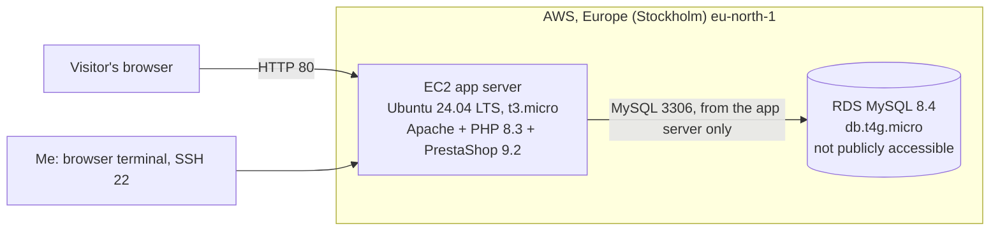

# PrestaShop on AWS: a two-tier deployment lab

A hands-on cloud and security lab. I deployed the open-source e-commerce platform PrestaShop on AWS, with the web application and the database on **two separate machines**, using free-tier resources only, and then locked the setup down.

## Architecture



| Layer | Service | Details |
|---|---|---|
| Application | EC2 | Ubuntu 24.04 LTS, t3.micro, 15 GiB gp3, Apache, PHP 8.3 |
| Database | RDS | MySQL 8.4, db.t4g.micro, 20 GiB, autoscaling off, public access off |
| Software | PrestaShop 9.2 | Free, self-hosted "Classic" edition |
| Cost control | AWS Budgets | Zero-spend budget alert created first |

## What I did

1. Created an AWS account on the Free Plan and set a zero-spend budget alert first.
2. Launched the EC2 app server and replaced the launch wizard's "allow all traffic" rule with three specific rules.
3. Created the RDS MySQL database on its own machine and linked it to the app server, so AWS generated security groups that let only that server reach it.
4. Connected through EC2 Instance Connect, patched the system, and installed Apache, PHP 8.3 and the PHP extensions PrestaShop needs.
5. Downloaded PrestaShop from the official site, extracted it into Apache's web folder, and ran the web installer against the RDS endpoint.
6. Removed the installer folder and confirmed the admin folder had been renamed.

Full walkthrough with commands: [docs/implementation-steps.md](docs/implementation-steps.md)

## Security decisions

| Decision | Why |
|---|---|
| SSH (22) allowed from my own IP only | Only I can attempt to log in; the default rule exposed every port to the internet |
| Database kept off the app server and set to no public access | A compromise of the web server does not hand over the data directly, and the database cannot be reached from the internet |
| Database reachable only from the app server's security group | Least privilege between the two tiers |
| Installer pointed at the RDS endpoint, not the default `127.0.0.1` | `127.0.0.1` would have put the database on the same machine |
| Install folder deleted after setup | Anyone could re-run the installer and take over the shop |
| Random database table prefix and auto-renamed admin folder | Small extra hurdles for automated attacks |
| Free-tier sizes, storage autoscaling off, budget alert | Cost and resource growth stay predictable |

More detail: [docs/security-notes.md](docs/security-notes.md)

## Screenshots

Screenshots of the console and each configuration decision are in [screenshots/](screenshots/). See the list in [screenshots/README.md](screenshots/README.md).

## Lessons learned

- **The browser terminal does not connect from your own IP.** EC2 Instance Connect connects from AWS's own address range, so an SSH rule limited to my IP blocked it. I added a rule for only that small range for the region (a /30, four addresses) and planned to remove it afterwards.
- **Read the installer defaults.** PrestaShop's installer suggests `127.0.0.1` for the database, which would have silently placed the database on the web server.
- **Pick an LTS image deliberately.** The launch wizard offered a newer Ubuntu release first. I chose Ubuntu 24.04 LTS, whose PHP 8.3 meets PrestaShop 9's requirement of PHP 8.1 or newer.
- **RDS "Easy create" is not the same as "Full configuration".** The quick option created the wrong engine for this lab, so I used full configuration to choose MySQL and set connectivity myself.
- **A default AWS address has no HTTPS certificate**, so the installer's SSL option had to stay off.
- **The public address changes if the instance is stopped and started.** PrestaShop stores its address, so a stop/start would break the shop unless an Elastic IP or domain name is attached.

## Limitations and next steps

- HTTP only. Next: register a domain, point it at the server, and add a free Let's Encrypt certificate to turn on HTTPS.
- Scan my own deployment (Nmap, Nikto, OWASP ZAP) and write up the findings.
- Add fail2ban for SSH and a web application firewall in front of the shop.
- Rebuild the whole setup as code (Terraform) so it can be created and destroyed in one command.
- Automated database backups and a tested restore.

## Clean-up

When finished: terminate the EC2 instance, delete the RDS instance (and its automated backups), and remove the extra SSH security group rule. This avoids using up credits.

## Repository layout

```
.
├── README.md
├── docs/
│   ├── implementation-steps.md   Step-by-step walkthrough with commands
│   └── security-notes.md         Security review of the setup
├── screenshots/                  Console and configuration screenshots
├── scripts/
│   └── setup-server.sh           The server commands, collected for reference
└── LICENSE
```

## Licence

MIT, see [LICENSE](LICENSE). PrestaShop is a separate project with its own licences.
